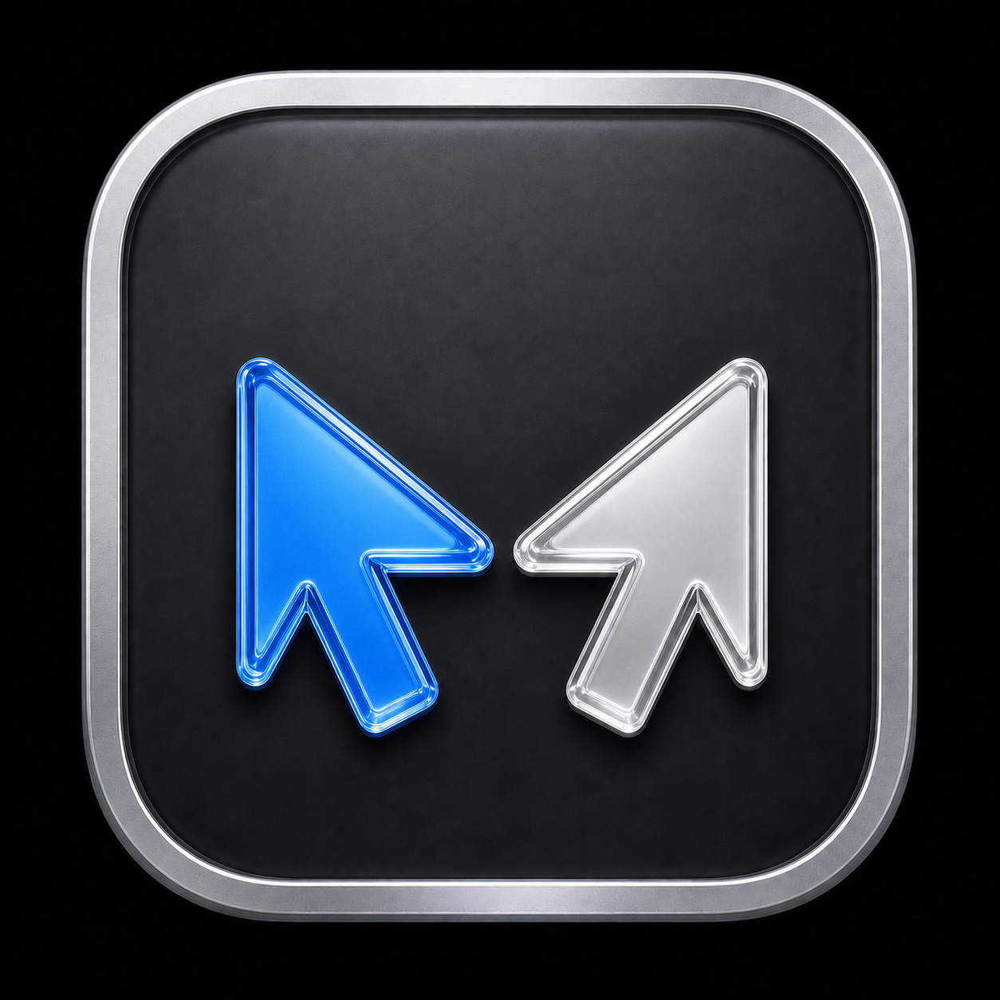

# DoubleMouse

<p align="center">
  
</p>

Ever wondered how to be faster on your Mac? What if you had two physical mice, each with its own pointer?

**DoubleMouse** is an open-source macOS menu bar app for two pointing devices: two physical mice, or your MacBook's built-in trackpad plus one external mouse. Both pointers move simultaneously, and each can click, scroll, and drag. It is also handy in classrooms and support sessions, where teacher and student can each keep a hand on the computer without negotiating custody of the cursor.

## Download

- [Download DoubleMouse 1.3.0 for macOS from GitHub](https://github.com/franciscoxc/DoubleMouse/releases/download/v1.3.0/DoubleMouse-1.3.0.dmg)
- [Project page](https://franxc.com/doublemouse/)

The app requires two pointing devices: two physical mice, or the built-in MacBook trackpad plus one external mouse. The downloadable build supports Apple Silicon and Intel Macs running macOS 13 or later.

## Install

1. Open the DMG and drag DoubleMouse to Applications.
2. Launch DoubleMouse and grant Accessibility permission when macOS asks.
3. The first time two pointing devices are connected, DoubleMouse asks which one moves the blue pointer: click **Use This Mouse** with that mouse. To change it later, open `Blue Pointer` in the menu bar and pick the device by name, or use `Choose by Clicking…`.
4. If the menu says macOS won't hand the mouse over, or DoubleMouse says it didn't see a click you made with a mouse, enable DoubleMouse under System Settings > Privacy & Security > Input Monitoring.
5. Turn on `Open at Login` in the menu bar if you want DoubleMouse running all the time.

The published DMG is signed with a Developer ID and notarized by Apple, so it opens without a Gatekeeper prompt. You still have to grant Accessibility, and on some Macs Input Monitoring, because that is what the app needs to do its job.

Updating from 1.2.1 or earlier? Those builds had a different signature, and macOS keeps their Accessibility entry: its switch can show as on while it still belongs to the old build, and the blue pointer moves but does not click. Remove DoubleMouse from the Accessibility list with the minus button, or run `tccutil reset Accessibility com.franxc.doublemouse`, then open DoubleMouse and allow it again.

## Updates

`Check for Updates…` in the menu bar asks GitHub for the latest release. When there is a newer one, DoubleMouse shows its notes, downloads the disk image, checks that it is signed by the same developer, and replaces itself. That is the only time the app goes online, and only when you choose it. Your permissions carry over, because the signature stays the same.

## Features

- Truly simultaneous movement of the normal macOS cursor and the blue pointer.
- Left, right, and middle buttons on the blue pointer, with double clicks, and Shift, Control, Option, or Command held on the keyboard.
- Press and hold, and drag-and-drop, with either pointer.
- Pause Blue Pointer hands the blue mouse back to macOS when it needs what only the regular pointer has, such as hover. Resume brings the blue pointer back where the arrow is.
- Vertical and horizontal scrolling at the blue pointer location.
- Every connected display, including with "Displays have separate Spaces" turned on.
- Adjustable blue pointer speed and optional acceleration, so a high-DPI mouse can be matched to the system cursor.
- The chosen blue device is remembered between launches.
- External USB and Bluetooth mouse support.
- MacBook trackpad plus external mouse support when macOS exposes both HID devices.
- Compact menu bar with device selection, Open at Login, and Check for Updates.
- No analytics, accounts, or kernel extension, and no network access except when you choose Check for Updates.

## How It Works

DoubleMouse opens HID devices independently and takes exclusive user-space ownership of the selected blue-pointer device. macOS continues to own the normal cursor, while DoubleMouse draws the blue pointer and emits its actions at the correct screen coordinates. It never takes the last pointing device: with only one connected, macOS keeps it.

The implementation uses public AppKit, IOKit, Accessibility, and CoreGraphics APIs. It does not install a driver or system extension.

## Limitations

- macOS still has one global mouse-button state, so two simultaneous drag operations are not supported.
- Only the blue pointer's left button holds and drags. Its other buttons click when released.
- The blue pointer does not trigger hover: buttons do not highlight under it, tooltips do not appear, and submenus do not open. macOS keeps a single cursor position, so putting the real cursor on the blue pointer and bringing it back on every movement would leave the real one jittering constantly. Clicking, scrolling, and dragging are unaffected. When the blue mouse needs hover, `Pause Blue Pointer` hands it the regular pointer until you resume.
- While the blue pointer clicks, drags, or scrolls, the regular arrow flickers at the blue pointer for an instant. macOS has one cursor, and each blue action borrows it.
- A trackpad works as the regular pointer next to a blue mouse. The original Magic Trackpad cannot be the blue pointer, because it does not send the plain movement reports a mouse does. Built-in trackpads and the newer Magic Trackpads have not been tried as the blue pointer.
- Some games, remote desktops, canvases, or custom controls may reject synthetic pointer events.
- The blue device is remembered by USB/Bluetooth port, so moving a mouse to a different port clears the selection.

## Run From Source

```sh
swift run DoubleMouse
```

The logic that can go wrong silently (pointer scaling, click counting, display edges, and the updater's checks) has a self-check, which CI also runs on every push and pull request:

```sh
swift run DoubleMouse --selftest
```

When running from Terminal, macOS assigns the relevant privacy permissions to Terminal. The packaged app requests them as DoubleMouse.

## Build The DMG

```sh
DEVELOPER_DIR=/Applications/Xcode.app/Contents/Developer scripts/package-release.sh 1.3.0
```

The version is required. The script uses only native macOS tools and writes the DMG plus SHA-256 checksum to `dist/`. Without signing variables it signs ad hoc, which needs no certificate but leaves the first launch behind a Gatekeeper warning.

## Notarize The DMG

Notarization removes that warning. It needs a Developer ID Application certificate, which is not the same as the Apple Development certificate Xcode creates for local builds, and a stored notarytool credential profile:

```sh
xcrun notarytool store-credentials doublemouse --apple-id <apple-id> --team-id <team-id>
```

That command prompts for an app-specific password, generated at appleid.apple.com, and keeps it in the login keychain. Then build with both variables set:

```sh
CODESIGN_IDENTITY="Developer ID Application: <name> (<team-id>)" \
NOTARY_PROFILE=doublemouse \
DEVELOPER_DIR=/Applications/Xcode.app/Contents/Developer \
scripts/package-release.sh <version>
```

The script then signs with the hardened runtime, runs the self-check on the signed app, submits the disk image, waits for the result, staples the ticket, and verifies the image the way Gatekeeper does. The checksum is written after stapling, since stapling rewrites the disk image.

The updater installs only builds signed by the team in `Updater.team`. If you sign with your own Developer ID, put your Team ID there: the self-check stops the build when the two differ, because an app that demands another team's signature could never update itself.

Signing says nothing about the source, which stays MIT and complete: it only certifies who built one particular binary. A build you make yourself is ad-hoc signed and not notarized, so macOS will ask you to approve its first launch even though the published DMG opens without a prompt. That difference is expected. The signing key belongs to the maintainer and cannot be reproduced from this repository, which is the point of it.

## Contributing

Issues and pull requests are welcome. Include your macOS version, Mac model, pointing-device models, connection types, and whether the problem affects movement, clicks, scroll, or dragging.

## License

MIT. See [LICENSE](LICENSE).
